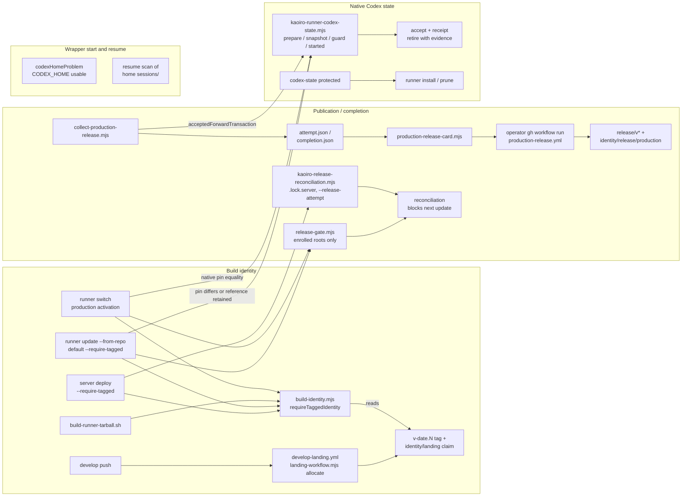

# Reduce release publication and native Codex state protection

Tracking: [issue #709](https://github.com/sakuraiyuta/kaoiro/issues/709)
(parent [issue #704](https://github.com/sakuraiyuta/kaoiro/issues/704)).
Decision record: [ADR-0069](../adr/0069-reduce-release-publication-and-native-state-protection.md).
Base of the analysis: `a51a64ca5200198e9f6226399863b963f00bf3bf`; every
`file:line` refers to that commit.

This page is a design for review. It changes no code, workflow, repository
variable, ruleset, tag or production installation. Each landing unit in
section 7 is a separate issue with its own design review where noted, and
every operator operation it names needs its own approval.

Claims are marked **(measured)** with the probe in section 9, **(read)** when
they come from reading code or documents at the base commit, and
**(unmeasured)** when nothing has established them yet. Nothing in this design
is approved while it depends on an unmeasured premise that section 9 lists as
blocking.

## 1. Operator decision this design implements

Operator decision of 2026-10-22, recorded on [issue #709](https://github.com/sakuraiyuta/kaoiro/issues/709):

1. Option A. Stop per-develop-push landing tags and the hourly
   reconciliation. Stop the receipt-to-`workflow_dispatch` identity
   publication and its repository-variable gates. Keep lockstep component
   updates (server and runner at one commit). Release records rely on the
   production release tag and the release note. Option B (component-wise
   release) is not pursued now.
2. Reduce the native Codex state layer to what a wrapper needs to start and
   resume correctly. Everything else needs no strict protection.

Options B and C of the original issue are therefore not developed here.
Option C's "streamline the ordinary path" is subsumed: the ordinary path
shrinks because the layers behind it are removed.

## 2. Three concepts and their dependencies

[Issue #709](https://github.com/sakuraiyuta/kaoiro/issues/709) asks to separate three concepts before deleting anything.

| Concept | What it answers | Current owner (read) |
|---|---|---|
| Build / artifact identity | Which source does this artifact contain? | `scripts/build-identity.mjs`, `with-build-identity.mjs`, frozen identity JSON, `verify-release.mjs`, `--version --json`, health `build_identity_formats` |
| Publication / completion | Was this commit landed, deployed and verified, and is that recorded outside the host? | `develop-landing.yml` + `scripts/landing-*.mjs`; `production-release.yml` + `scripts/production-release-*.mjs`, `collect-production-release.mjs`, `production-runner-worker.mjs`; enrolled branches in the runner updater/switch/bootstrap and the server deploy CLI |
| Native Codex state | Can the Codex binary of the running release open this home and resume its threads? | `runner/deploy/kaoiro-runner-codex-state.mjs`, `codex-snapshot.mjs`, `codex-service.mjs`, `codex-native.mjs`; the Codex branches of `kaoiro-runner-update.sh` / `kaoiro-runner-switch.sh` / `kaoiro-runner-install.sh` |

Call and data dependencies (read):

Consequences for the deletions:

- Build identity depends on landing tags. Stopping allocation without a new
  tag source makes every new commit `untagged`, and production builds and
  `--from-repo` updates refuse it. The replacement tag source (unit P1) must
  land before allocation stops.
- The completion collector depends on native-state acceptance
  (`acceptedForwardTransaction`, `kaoiro-runner-codex-state.mjs:139`). Removing
  acceptance (unit N2) after the collector is gone (unit P3) avoids a
  temporary compatibility shim.
- Native-state protection does not depend on publication. Removing GitHub
  publication removes no runner Codex state test; the six slow files belong to
  the native-state layer alone (section 6).
- Runner start and resume depend on `CODEX_HOME` usability and on the home's
  contents, not on any `codex-state` record (read: `runner-cli.ts:258-262`,
  `supervisor.ts:1449-1453`, `sessions.ts:606-727`).

## 3. Publication layer (option A)

### 3.1 Current state (measured, 2026-10-22)

- `develop-landing.yml` is active and allocating: 133 runs, the latest
  push and schedule runs succeeded; 68 `identity/landing/*` claims exist.
- `production-release.yml` has 0 runs. `KAOIRO_RELEASE_ENABLED` is `false`.
  No `release/*` or `identity/release/production/*` tag exists. The
  receipt-to-dispatch path has never published.
- The tag ruleset "Kaoiro immutable release identities" is active.
- The production runner installation inspected has no enrollment descriptor
  (`release-authority.json`), no alias map and no `production-attempts/`.
- Server enrollment is **(unmeasured)**; see U2 in section 9.

### 3.2 Guarantees, owners and decisions

| Id | Guarantee | Owner (read) | Decision |
|---|---|---|---|
| G1 | Server and runner are updated to the same commit | runbooks, release note "Upgrading" | keep |
| G2 | An artifact attests its full SHA and dirty flag; one frozen identity feeds every component build; source is checked before and after building | `build-identity.mjs`, `with-build-identity.mjs`, `verify-release.mjs` | keep |
| G3 | A new identity format is not started against readers that lack it | health `build_identity_formats`, fleet snapshot in deploy/update | keep |
| G4 | A production build or forward activation uses an exact tag at HEAD, never an ancestor or a label | `requireTaggedIdentity`, switch activation gate | keep; the tag source changes (P1) |
| G5 | Existing `v*` / `identity/*` / `release/*` tags cannot be moved or deleted | tag ruleset | keep (no ruleset change) |
| X1 | Every successful develop push tip receives a contiguous `vYYYY.MM.DD.N` and a same-object claim; hourly reconciliation repairs missed allocations; operator repair tooling for workflow-permission refusals | `develop-landing.yml`, `scripts/landing-*.mjs` | retire (P2) |
| X2 | A deployment yields a write-once completion receipt bound to server DONE, runner worker facts, registration, Codex acceptance and the canary, published as `release/v*` through operator `workflow_dispatch`; unfinished or unpublished attempts block the next update | `production-release.yml`, `scripts/production-release-*.mjs`, `collect-production-release.mjs`, `production-runner-worker.mjs`, enrolled branches | retire (P2 workflow, P3 code) |
| X3 | Repository-variable gates bind workflow admission to a reviewed control SHA and V9/V10 evidence | `KAOIRO_*` repository variables, `release-automation-gate.mjs` | retire with X1/X2 |

### 3.3 The release tag that replaces landing tags (P1)

The production release tag is created at release time on the commit being
released, before the build. Provisional choice (decision point D1):

- Name: `vYYYY.MM.DD.N`, the existing namespace. Release notes, labels, the
  dashboard and `build-identity.mjs` already use it, and the ruleset already
  protects it. Historical `v*` tags mean "landed"; tags after the cutover mean
  "released". The cutover commit and date are recorded in ADR-0069 and in
  `docs/release/README.md`, so the two meanings are never inferred from the
  name alone.
- Form: an annotated tag whose message is a bounded schema-2 JSON
  `{"schema":2,"kind":"release","revision":"<40-hex>","branch":"develop"}`.
  No claim ref is created.
- Reader: `computeBuildIdentity` / `requireTaggedIdentity` accept an exact
  HEAD `v*` tag that is either a valid historical schema-1 landing pair (as
  today) or a schema-2 release annotation whose `revision` equals HEAD. A
  schema-2 tag with a claim, a conflicting second exact tag, a lightweight
  tag or a mismatched revision refuses, as broken pairs do today. Origin
  read-back of the selected tag stays. A commit that already carries a valid
  historical landing pair is released under that tag; no second tag is
  created for it.
- Numbering: `N` is the next unused number for the UTC day among existing
  `v*` tags. Contiguity is no longer verified; tag-name uniqueness is enforced
  by Git and the ruleset. A small helper (`scripts/release-tag.mjs plan`)
  prints the next name and the `git tag -a` / `git push origin
  refs/tags/<name>` commands; it never pushes.
- Who creates it: the release operator (the operator, or a director whose
  release is approved). Creating `v*` tags needs ordinary Contents-write
  authority; the active ruleset has only `update` and `deletion` rules and no
  bypass actors (measured, read-back 2026-10-22). A tag push by a
  non-workflow principal under this ruleset is **(unmeasured)** on the real
  repository; the first P1 release tag is that measurement. Whether an agent
  session may push a tag is a harness/permission question for the operator
  and is not changed here.

Normal path after P1-P3: choose the commit, write the release note, create
and push the release tag, build with `--require-tagged`, update server then
runner, run the canary, commit the release note. Failure/recovery: a failed
build or deployment leaves the tag in place; redeploying the same commit
reuses it. A tag on a commit that is never deployed is harmless and is noted
in the next release note. A wrong tag is not moved; the malformed-tag
procedure (kept, section 3.5) applies.

Lost by X1: a version for every develop commit (non-release builds become
`untagged / develop / <hash>`), automatic landing evidence independent of the
pusher, and claim-based detection of hand-made `v*` tags (a hand-made `v*`
tag is now the intended release authority).

### 3.4 Retiring X2/X3

Lost: machine-checked completion evidence bound to one receipt; the admission
block on unfinished or unpublished attempts; detection of an omitted
publication; the digest-pinned enrolled tool closure and the retained worker
unit with typed `ExecStartEx` evidence. Since `KAOIRO_RELEASE_ENABLED` is
false and no receipt was ever published (measured), the publication half has
no consumer. The enrolled half has no consumer on the inspected runner; the
server side is U2.

Retained in place of X2: the release note (deployed commit, previous release,
range, class), the release tag, and the existing per-operation checks that do
not depend on enrollment: deploy health/full-SHA checks, runner
`--version --json` attestation and registration match, ordinary `--detach`.

### 3.5 Code, tests, runbook sections that go away

Candidate set (read). Each unit confirms it with an import/reference sweep
before deleting; a file still imported by kept code stays.

| Unit | Code | Tests | Runbook / docs |
|---|---|---|---|
| P1 | none removed; `build-identity.mjs` reader extended, new `scripts/release-tag.mjs` | `scripts/test` build-identity cases extended; `releaseSwitch` "requires a landing tag" case rewritten for the release tag | `build-identity-and-release-tags.md` "Identity" rewritten; `docs/release/README.md` gains the tag step; `runner-update-and-rollback.md` "Build identity preconditions" |
| P2 | `.github/workflows/develop-landing.yml`, `production-release.yml`; `scripts/landing-workflow.mjs`, `landing-tags.mjs`, `landing-backlog.mjs`, `landing-repair*.mjs`, `production-release-workflow.mjs`, `production-release-tags.mjs`, `production-release-card.mjs`, `release-automation-gate.mjs` | `scripts/test/landing-reconciliation.test.mjs`, `landing-repair.test.mjs`, `mock-github-api.mjs`, `fixtures/landing-repair-fixture.mjs`; CI job `release-identity` loses the landing file | `build-identity-and-release-tags.md`: "Automation activation and trust", "Repair", "Recorded repair of a historical landing" removed; "Repairing a malformed reserved tag" kept, shortened |
| P3 | `collect-production-release.mjs`, `production-runner-worker.mjs`, the remaining `scripts/production-release-*.mjs`; `runner/deploy/release-gate.mjs`; enrolled branches in `kaoiro-runner-update.sh` / `-switch.sh` / `-bootstrap.sh` / `-common.sh`; `release-tools` staging in `build-runner-tarball.sh:203`; `server/deploy/kaoiro-release-reconciliation.mjs` and the enrolled branches / `--release-attempt` argv of `kaoiro-server-deploy.mjs` and `kaoiro-deploy-recovery.mjs:186`; `check-release-child-environments.mjs` if nothing else uses it | `scripts/test/production-release*.test.mjs`, `production-runner-worker.test.mjs` (CI job `release-identity` removed); `runner/test/releaseReconciliation.test.ts`; enrolled-fixture cases of `server/deploy/test/recovery*.test.mjs`, `test-support/fake-release-exporter.mjs` | `build-identity-and-release-tags.md`: "Enrolled production authority", "Common production checkpoint", "Reconciliation and explicit recovery" (with the release state table) removed; matching paragraphs of `runner-update-and-rollback.md`, `server-update-and-rollback.md`, `runner-install.md`, `reference/deployment/transactions-and-identity.md`, `docs/README.md` |

Sizes at the base commit (measured with `wc -l`): 26 publication scripts,
8,104 lines; 10 publication test files, 4,269 lines; the two workflows, 158
lines. The CI `release-identity` jobs took 15 s and 26 s ([issue #709](https://github.com/sakuraiyuta/kaoiro/issues/709)); their
removal is not a CI-time argument.

### 3.6 Unfinished records and operator operations

- Landing allocations: once `KAOIRO_LANDING_ENABLED=false`, pushes between the
  last allocation and the switch stay untagged. They are not repaired; P1
  release tags supersede them. Existing pairs remain immutable and readable.
- Repository variables: the operator sets `KAOIRO_LANDING_ENABLED=false`
  after P1 is deployed, and deletes the `KAOIRO_*` variables after P2 lands.
  `KAOIRO_RELEASE_ENABLED` is already false.
- Ruleset: unchanged. It costs nothing and keeps historical tags immutable.
- Enrolled roots: P3 requires U2. If any root is enrolled, its unfinished
  attempts are first closed with the current tools (`abandon`,
  `retire-deployed` or `quarantine`), and the descriptor and canonical history
  are moved, unmodified, to private storage before P3 is deployed. A
  descriptor left in place after P3 is ignored by the new code; P3 adds one
  warning line when it sees one, so a forgotten root is visible.
- Old tools reading new records: nothing new is written by P1-P3 except the
  schema-2 tag annotation. An older `build-identity.mjs` treats a schema-2 tag
  without a claim as a broken pair and refuses a production build. That is
  fail-closed and only matters for building a post-cutover tag with
  pre-P1 code, which the runbook forbids.

## 4. Native Codex state: the minimal protected boundary

### 4.1 What "wrapper start and resume" needs

A Codex wrapper starts correctly when the runner launches it with a usable
`CODEX_HOME`, the pinned binary can open that home's databases, and the
stored login is valid. It resumes correctly when the home still holds the
thread's rollout under `sessions/` and a state database the binary can read.
From this, the boundary has nine invariants. Everything outside them is
unprotected by design.

| Id | Invariant | Why start/resume depends on it |
|---|---|---|
| B1 | The runner refuses Codex launches when `CODEX_HOME` is unusable, with a reason | otherwise every wrapper crash-loops (`codex-home.md`) |
| B2 | Code is never switched so that a Codex native binary different from the one that last opened the home starts on it, unless the home was just restored from a snapshot taken under that binary, or is fresh | a differing binary may migrate or fail to open the databases; an older binary on migrated state is the start/resume risk (U1) |
| B3 | Restore never brings back older credentials (`auth.json`, `.credentials.json`, `secrets/`, `mcp-oauth-locks/`); the current entries are moved, not copied or read | an older refresh token can be revoked, and the wrapper then cannot authenticate |
| B4 | A snapshot never includes credentials, and unknown home entries refuse rather than being copied blindly | an unrecognized credential-bearing file would be rolled back by restore (B3) |
| B5 | Home state is copied or replaced only while the managed runner is inactive, `MainPID` is 0 and the service cgroup is empty | a live writer makes the SQLite/WAL copy inconsistent |
| B6 | A snapshot is verified against its manifest hash before it replaces the live home | a corrupt copy replaces a working home |
| B7 | Replacing the home is resumable and non-destructive: the old home is renamed aside, never deleted, and an interrupted replacement leaves a record naming both paths | an interruption between the two renames leaves no home at the configured path |
| B8 | The home a restore writes is the home the runner will use next (resolved `CODEX_HOME` path from the unit and `runner.env`) | restoring a different directory leaves the real home unchanged |
| B9 | The release whose native binary a retained snapshot needs is not pruned while the snapshot is retained; a failure before any state change restarts the unchanged source | restoring a snapshot without its binary cannot start; a stopped runner after a harmless failure is an outage |

B2 is enforced whether or not records exist (`guard` compares native hashes
directly, `kaoiro-runner-codex-state.mjs:209-213`), and this stays.

Whether to keep cross-pin rollback at all (and hence snapshots) is decision
point D2 (section 8). This design keeps it, simplified: without a snapshot,
the only exit from a bad pin update is fixing forward or a fresh setup that
loses every Codex login and thread, which is exactly a resume failure for all
Codex peers.

### 4.2 Safeguards: keep / simplify / retire

| Id | Safeguard (read) | Invariant | Decision | What changes / what is lost |
|---|---|---|---|---|
| S1 | `codexHomeProblem()` launch refusal; `CODEX_HOME` withheld from non-Codex children and tool shells | B1 | keep | product code, not the state helper |
| S2 | Native pin equality guard in switch/updater (`guard` without a transaction) | B2 | keep | unchanged |
| S3 | Credential exclusion from snapshots and move-not-copy on restore | B3, B4 | keep | the per-credential `credential-intent/moved:<name>` phases collapse into the single replacement record of S11 |
| S4 | Home classification, fail closed on unknown names (`inventory`) | B4 | keep | `codexHomeClassification` stays (1.7 s) |
| S5 | Post-stop check: inactive, `MainPID` 0, empty cgroup (`assertStopped`); unified cgroup v2 required | B5 | keep | |
| S6 | Pre-stop foreign-UID walk of the runner cgroup (`assertOwnedCgroup`) | none | retire | lost: refusal before stop when a foreign process sits in the cgroup. S5 still refuses after stop and the source is resumed (S13) |
| S7 | Snapshot manifest and hash verification before replacement | B6 | keep | |
| S8 | SQLite migration-level diagnostics and throughput estimate | none | retire | lost: rollback diagnosis data. The capacity check stays (a full disk breaks start) |
| S9 | Static/live binding: unit file hashes, `runner.env` `sourceHash` and device/inode, manager environment, `ExecStart`, live `MainPID` home binding (`codex-service.mjs:73-135`) | B8 | simplify | compare only the resolved `CODEX_HOME` path from the unit and `runner.env` with `--codex-home`, at prepare and before restore. Lost: refusal on any `runner.env` byte or inode change; editing `runner.env` no longer strands rollback points |
| S10 | Acceptance evidence file, binding receipt, `sequence`, `awaiting-acceptance` gate | none | retire | the updater completes the forward after its own start check (active, `MainPID`, attested release). Lost: an operator attestation that Codex started and history resumed before the next update; it becomes a runbook check, not a gate |
| S11 | 16-phase transaction machine plus owner PID/start-tick proofs (`codex-owner.json`) | B7, B9 | simplify | forward: `prepared` → `snapshot-verified` → `completed` / `failed`; restore: `replace-intent` → `restored`. The `.lock.update` directory stays the mutual exclusion; the updater PID is recorded for diagnosis only |
| S12 | Restore lineage: newest-unrestored rule, `acceptedHome`, `recoveryLineage`, chained restores | none | retire | restore takes an explicitly named retained snapshot whose source native equals the release being started. Lost: refusal to restore an older snapshot when a newer one exists; restoring an older snapshot quarantines newer threads, as restore already does |
| S13 | Code-only recovery for a never-started candidate; unchanged-source restart (`restartSource`) | B9 | simplify | one rule: if the candidate never started, restart the source with the home untouched; otherwise restore |
| S14 | Legacy (pre-receipt) record handling and ignored `barriers/` | none | retire | the new helper refuses while any old record is non-terminal or any old reference is unretired (section 4.4) |
| S15 | Retirement with a gate-6 evidence file; `abandon` with owner-state checks | none | simplify | `prune <root> <uuid>` deletes a retained snapshot and marks it retired, no evidence file. A forward that failed before writing its snapshot is `failed` and does not block the next update, so `abandon` disappears |
| S16 | Release prune protection for references and unfinished transactions (`protected`) | B9 | keep | narrowed to retained snapshots' source releases and an in-flight replacement |
| S17 | `acceptedForwardTransaction` export for the completion collector | none | retire | removed with P3 |
| S18 | Snapshot privacy (0700/0600, same user), restore at the original canonical path | B3, B8 | keep | |

The result keeps nine invariants with one small record type, and drops the
registry-wide validation that makes every scan refuse on one malformed field.

### 4.3 Failure paths of the reduced design

| Failure point | State left | Exit |
|---|---|---|
| Classification, capacity or path check fails before stop | nothing; source running | fix the cause, retry |
| Stop leaves a process in the cgroup | forward `prepared`; source stopped | updater restarts the unchanged source, records `failed` |
| Snapshot copy or verification fails | forward `failed`; staging removed when possible, else named in the record | source restarted; a leftover staging directory is reported by the next update (warning, not a refusal) |
| Switch fails, candidate never started | forward `snapshot-verified` | source restarted with the home untouched; record `failed` |
| Candidate started, then the operator wants the old code | forward `completed`, snapshot retained | `--restore-codex-backup <snapshot>`: stop, verify, move credentials, rename home aside, promote, start source release |
| Restore interrupted between renames | restore `replace-intent` naming home, staging and aside paths | rerunning the same restore finishes or reverses the renames; the runner refuses Codex launches meanwhile (B1) |
| Restore cannot succeed | home or staging preserved | fresh setup (`codex-home.md`), unchanged |

The runner-side transaction table that [issue #695](https://github.com/sakuraiyuta/kaoiro/issues/695) L2/L3 planned for the
current machine is re-derived for this smaller machine (section 5).

### 4.4 Existing records and cutover

- Inspected production runner (measured): every recorded Codex state
  transaction is terminal (`retired`) and every backup reference is retired
  with its snapshot deleted. No restore has ever been recorded. Other runner
  installations are **(unmeasured)**, U3.
- The reduced helper writes `codex-state/v2/`. The old `transactions/` and
  `backups/` directories are left untouched. Before any state-aware action
  the new helper reads only `phase` of old transactions and `retired` of old
  references; any non-terminal transaction or unretired reference refuses with
  "Resolve old Codex state records with the previous tool release". That
  exit uses the last pre-N2 tool release, which N2's runbook names; the new
  helper never converts or edits old records.
- An old helper does not read `v2/`. Rolling the runner back across N2 while
  a v2 snapshot is retained would hide that snapshot from the old tool; the
  runbook therefore prunes or restores v2 snapshots before such a rollback.
  Same-native code-only rollback is unaffected.
- Stopping and restarting the agent that may initiate an update: unchanged.
  The update is queued with `--detach` from the new release's physical tool
  path and the agent ends its turn after enqueue.

## 5. Relation to issues #695, #707 and #704

**[Issue #695](https://github.com/sakuraiyuta/kaoiro/issues/695) L1b, L4, L5 (server side): not affected by the native-state
boundary.** They change the server deploy transaction (destructive rollback
resume, 5-b acknowledgement, compose override hashes). None of them reads or
writes Codex state. They do touch the same files as P3's server part: the
enrolled `.lock.server` path, the `--release-attempt` argv emitted by
`kaoiro-deploy-recovery.mjs:186`, and the enrolled fixture of the server
property test (issue-695 plan section 7.1 item 8). Recommendation: L1b, L4
and L5 continue as designed but add no new enrolled-specific behavior. P3
lands after them, or rebases onto them if it is ready first, and removes the
enrolled rows from the server property test in the same change. L1b's live
fleet admission uses `build_identity_formats` (G3), which stays.

**[Issue #695](https://github.com/sakuraiyuta/kaoiro/issues/695) L2, L3 (runner side): re-scope.** Their states (sections 3.2 and
5.4 of the issue-695 plan) belong to the machine retired by S10-S15. After N3
the runner has six states (section 4.3). Recommendation: fold the runner
recovery table and its property test into N3, sized for that machine, and
close L2/L3 as superseded. Alternative: keep the L2/L3 issue numbers and
rewrite their scope after N3 (decision point D4). [Issue #531](https://github.com/sakuraiyuta/kaoiro/issues/531) (stopped forward
keeps its staging) is covered by the `failed` path of section 4.3.

**[Issue #707](https://github.com/sakuraiyuta/kaoiro/issues/707): close as superseded.** Its targets `staticShape`,
`validateReceipt` and `validateTransactionState`
(`kaoiro-runner-codex-state.mjs:35-73`) are retired by N2, and its
test file `codexReceipt.test.ts` is deleted. The record checks that remain are
small and live in the fast `codexState.test.ts`. If the CI measurement after
N3 still shows the workflow file as a bottleneck, a new, narrowly scoped issue
is opened against the new code.

**[Issue #704](https://github.com/sakuraiyuta/kaoiro/issues/704):** [issues #705](https://github.com/sakuraiyuta/kaoiro/issues/705) and [#706](https://github.com/sakuraiyuta/kaoiro/issues/706) are unaffected. The CI measurement that
the operator scheduled after [#709](https://github.com/sakuraiyuta/kaoiro/issues/709) and [#705](https://github.com/sakuraiyuta/kaoiro/issues/705) lands is taken after N3.

## 6. The six slow runner test files

Measured in CI run 39747478279 (job 119719445581): 172 tests, 1,471.904 s
accumulated.

| File | Tests | Accumulated | Fate | Unit |
|---|---|---|---|---|
| `codexStateWorkflow.test.ts` | 59 | 396.878 s | rewritten: keep cases for B2, B3, B5, B6, B7, B8, B9, capacity and stop-failure control flow (about 15); delete acceptance, retirement-evidence, `runner.env` identity, crossed-metadata and abandon cases | N1-N3 |
| `codexLineagePending.test.ts` | 8 | 260.690 s | deleted | N2 |
| `codexLegacy.test.ts` | 10 | 216.326 s | deleted; one fast case for the old-record cutover refusal goes to `codexState.test.ts` | N2 |
| `codexReceipt.test.ts` | 39 | 205.019 s | deleted | N2 |
| `codexLineage.test.ts` | 7 | 200.270 s | deleted | N2 |
| `codexForeignUid.test.ts` | 49 | 192.721 s | deleted; the post-stop population case ("still active after stop → no switch, source resumed") moves to the workflow file | N1 |

Supporting files `codexLineageHarness.ts` and `codexCgroupFixture.ts` are
deleted or reduced with them. `codexState.test.ts` (35 tests, 5.7 s) keeps
its snapshot and pin-guard cases and loses the three barrier cases.

Estimate, not a measurement: the rewritten workflow file at the current
per-case cost (about 6.7 s) would accumulate roughly 100 s, against
1,471.904 s today. Accumulated time is not wall time; the runner job wall time
after N3 is measured, not predicted ([issue #704](https://github.com/sakuraiyuta/kaoiro/issues/704) decision).

## 7. Landing units

One unit at a time, each independently revertible. "Operator op" items are
performed by the operator after review, never by an agent.

| Unit | Content | Depends on | Design review | Operator op |
|---|---|---|---|---|
| P1 | Release-tag reader (schema 2) and `scripts/release-tag.mjs plan`; runbook and release README | — | this design, plus the annotation grammar | deploy P1 to server and runner; then set `KAOIRO_LANDING_ENABLED=false` |
| P2 | Delete the two workflows, landing scripts, card/workflow scripts and their tests; docs | P1 deployed, allocation disabled | this design | delete `KAOIRO_*` repository variables |
| P3 | Delete completion/enrollment code in scripts, runner updater/switch/bootstrap, tarball staging and server deploy; tests; docs | P2; U2 measured; after [#695](https://github.com/sakuraiyuta/kaoiro/issues/695) L1b/L4/L5 or rebased on them | own short design (server and runner launch paths are high-risk: FS class) | if enrolled: close attempts and archive descriptors first |
| N1 | Compare only the resolved home path (S9; the full binding is still captured and stored, so records keep their format); retire the foreign-UID walk and the diagnostics (S6, S8) | — (parallel to P1-P3) | this design | none |
| N2 | `v2/` records and the reduced phase machine with the cutover refusal (S11); retire acceptance, receipts, lineage, legacy, barriers, evidence-gated retirement and `abandon` (S10, S12, S14, S15, S17); `prune`; unified never-started rule (S13); narrowed release protection (S16) | N1; P3 (collector gone) | own design round (record format and helper rewrite) | none |
| N3 | Runner recovery table and property test for the reduced machine, replacing [#695](https://github.com/sakuraiyuta/kaoiro/issues/695) L2/L3; final runbook rewrite | N2 | own design round (it replaces the L2/L3 design) | none |

Each N unit is a Codex state change on the runner's update path and follows
`high-risk-change-release.md` when deployed. Each one is validated with the
real updater against a disposable home: one forward across differing native
hashes, one restore, and the negative controls of section 10.

Estimated implementation size (estimate): P1 small; P2 deletion-heavy; P3
medium (touches high-risk launch paths); N1 small; N2 large (the helper
core); N3 medium.

## 8. Decision points (provisional conclusions)

| Id | Question | Provisional | Alternatives |
|---|---|---|---|
| D1 | Name of the production release tag | keep `vYYYY.MM.DD.N`, created at release time | `release/vYYYY.MM.DD.N` (namespace already protected, but the version source and labels need a second change) |
| D2 | Keep cross-pin rollback (snapshots) | keep, simplified | retire snapshots; keep only B1/B2/B5; cross-pin rollback means fresh setup and loses every Codex login and thread |
| D3 | After a pin update, wait for an operator check before the next update | no gate; the runbook asks for a first-turn and resume check | keep a one-line `confirm <uuid>` without an evidence file |
| D4 | Where the runner recovery table lives | fold into N3, close [#695](https://github.com/sakuraiyuta/kaoiro/issues/695) L2/L3 | keep L2/L3 and re-scope them after N3 |
| D5 | Unknown home entries | keep fail-closed (S4) | copy unknown entries and warn; accepts the B3 risk for new credential files |
| D6 | Repository variables after P2 | delete | leave them in place (harmless, but misleading) |

## 9. Unmeasured premises and probes

| Id | Premise | Blocks | Probe (read-only or disposable) |
|---|---|---|---|
| U1 | An older Codex native cannot reliably open or resume a home migrated by a newer native | nothing (B2 is kept either way); informs D2 | in a disposable directory, install two Codex pins from npm; start the newer `codex app-server` on an empty `CODEX_HOME`, create a thread with `thread/start` (no model turn), stop; start the older pin on the same home and call `thread/list` and `thread/resume`; record exit codes, `_sqlx_migrations` rows and errors |
| U2 | No server install root is enrolled and no canonical history holds unfinished attempts | P3 | operator, read-only on the server host: test for `realpath(<server-dir>)/.kaoiro-release-authority.json`; if present, run `production-release-card.mjs audit` with the current tools and record the result privately |
| U3 | Every other runner installation has only terminal Codex state records | N2 deployment on that host | on each runner host, read `phase` of `codex-state/transactions/*.json` and `retired` of `codex-state/backups/*.json` (field projection only; the records hold paths and environment, so never print them whole) |
| U4 | Disabling `KAOIRO_LANDING_ENABLED` makes both push and schedule runs skip allocation | P1 operator op | read: the `publish` job condition requires the variable (`develop-landing.yml:42-50`); after the change, read the next push run's job list and confirm `publish` is skipped and no new `v*`/claim appears |
| U5 | The CI wall-time effect of N1-N3 | none (reporting) | compare runner job wall time and accumulated test time on the N3 candidate with run 39747478279 |

## 10. Verification plan

- P1: build-identity unit cases for schema-1 pairs (unchanged), schema-2
  release tags, and refusals: lightweight tag, schema-2 plus claim,
  mismatched revision, two exact tags. Negative control: a schema-2 tag on a
  different commit must leave the build `untagged` and `--require-tagged`
  must exit non-zero. Real entry: `with-build-identity.mjs --require-tagged`
  and `build-runner-tarball.sh --require-tagged` in a disposable clone with a
  local tag.
- P2/P3: reference sweep (`grep` for every removed module name) shows no
  importer; full suite and CI on the candidate; the runner update and server
  deploy happy paths still pass their existing tests. Negative control: a
  leftover descriptor produces the warning and is otherwise ignored.
- N1-N3: per invariant, one failing case through the real updater entry:
  B2 differing native without snapshot refused before stop; B3 restore keeps
  the current `auth.json` bytes; B5 active service after stop leads to no
  switch and a resumed source; B6 corrupt snapshot refused before
  replacement; B7 kill between renames, rerun completes; B8 wrong home
  refused before stop; B9 the snapshot's source release survives prune.
  Cutover: an old non-terminal record refuses with the documented message;
  an all-terminal old registry passes.
- Docs: each removed runbook section has no remaining inbound link
  (`grep` for the anchor).

## 11. Documents to update

ADR-0066 (status: partly superseded by ADR-0069); ADR-0069 (accepted once
reviewed); `docs/operations/build-identity-and-release-tags.md`,
`runner-update-and-rollback.md`, `codex-home.md`, `server-update-and-rollback.md`,
`runner-install.md`, `production.md`, `high-risk-change-release.md`;
`docs/reference/deployment/transactions-and-identity.md`;
`docs/release/README.md`; `docs/README.md`; the issue-695 plan (section 8 unit
table). Each unit updates only the sections it changes.

## 12. Rollback of this decision

This page and ADR-0069 change no runtime behavior. P1 is additive (the old
reader path stays for schema-1 pairs). Re-enabling landing allocation after P2
means restoring the deleted workflow and scripts from Git history and setting
the variables again; historical tags are untouched throughout, so no identity
needs repair. N1-N3 cannot restore deleted acceptance or lineage records that
were never written; a revert brings back the code, and the old helper still
reads the old directories, which N2 leaves untouched.
